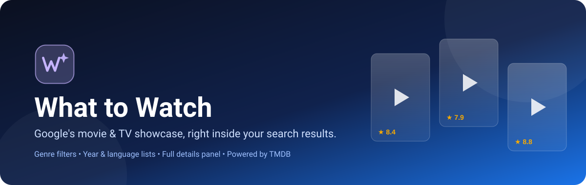
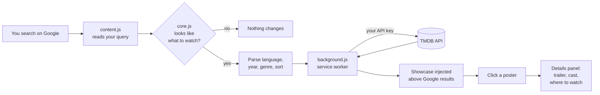

<div align="center">



<br/>


**Bring back Google's "What to Watch" showcase.**
Search things like `kdrama 2025`, `best horror movies` or `what to watch` and get a clean, clickable carousel of titles right above your Google results.

[Features](#-features) • [Install](#-installation) • [Get your API key](#-step-2--get-your-free-tmdb-api-key) • [How to use](#-how-to-use) • [Troubleshooting](#-troubleshooting)

</div>

---

## ✨ Features

| | Feature | What it does |
|---|---|---|
| 🔎 | **Smart query detection** | Understands searches like `kdrama 2025`, `turkish drama romance`, `latest anime`, `best horror movies`, `what to watch`. |
| 🎬 | **Showcase on Google** | Injects a scrollable carousel above the normal results on Google search pages. |
| 🏷️ | **Genre chips** | Filter by Action, Comedy, Horror, Romance, Sci-Fi and every other TMDB genre with one click. |
| 🌍 | **Language & year filters** | 17 languages (Korean, Japanese, Hindi, Urdu, Turkish, Thai, Spanish...) and years from 1979 to next year. |
| ↕️ | **Sorting** | Most popular, Top rated, or Newest. |
| 🎞️ | **Movies and TV tabs** | Switch between movies and TV shows instantly. |
| 📄 | **Full details panel** | Click any poster for a complete page of info (see below). |
| 🖥️ | **Full-page mode** | Click the toolbar icon for a standalone page with its own search box. |
| 🌗 | **Light and dark mode** | Automatically follows your system theme. |
| 🔒 | **Private by design** | Your API key is stored only in your browser. No tracking, no servers of ours. |

### 📄 What the details panel shows

- Poster, backdrop, title, year, **age certification**, runtime (or seasons and episodes) and genres
- **TMDB rating** and vote count, plus release status
- Buttons for **Trailer (YouTube)**, **Where to watch**, **IMDb** and **Search Google**
- **Where to watch** by region: Stream, Rent, Buy and Free, with provider logos
- Overview, director (or creator), original language, release date, network and studio
- **Cast** (top 14) with photos, linking to a Google search for each actor
- **More like this**: recommended titles you can click to keep exploring

---

## 🚀 Installation

> No build step, no `npm install`, no store account. It is plain JavaScript that you load straight into your browser.

### Step 1 - Download and load the extension

1. **Get the code**
   - Click the green **Code** button on this repository, then **Download ZIP**, and extract it
   - or clone it:
     ```bash
     git clone https://github.com/abdulhayeekamboh/WhatToWatch-Extension.git
     ```
2. Open your browser's extensions page:

   | Browser | Address |
   |---|---|
   | Google Chrome | `chrome://extensions` |
   | Microsoft Edge | `edge://extensions` |
   | Brave | `brave://extensions` |

3. Turn on **Developer mode** (toggle in the top-right corner).
4. Click **Load unpacked** and select the folder that contains `manifest.json`.
5. The extension's **Settings page opens automatically**. Keep it open and continue to Step 2.

### 🔑 Step 2 - Get your free TMDB API key

The extension gets all its movie and TV data from **[The Movie Database (TMDB)](https://www.themoviedb.org/)**. You use **your own** free key, so there are no shared limits and nothing is hard-coded in this project.

1. Create a free account at **[themoviedb.org/signup](https://www.themoviedb.org/signup)** and verify your email.
2. Go to **[Settings → API](https://www.themoviedb.org/settings/api)** and request an API key. Choose **Personal use** and fill in the short form.
3. Copy either of these (both work):
   - **API Key** (v3, a short 32-character string), or
   - **API Read Access Token** (v4, a very long string)

### ⚙️ Step 3 - Add the key to the extension

1. On the extension's **Settings** page, paste your key into **TMDB API key**.
2. Pick your **Region**. This controls the *Where to watch* providers and age ratings. Available regions:
   `US GB PK IN CA AU AE SA DE FR KR JP TR ES IT BR MX`
3. Click **Save**. You will see *"Saved. Reload your Google tab."*

You can reopen settings any time from `chrome://extensions` → What to Watch → **Details** → **Extension options**.

---

## 🎯 How to use

### On Google search

Just search the way you normally do. When your query looks like a "what to watch" search, the showcase appears above the results.

| Try searching | You get |
|---|---|
| `kdrama 2025` | Korean TV dramas from 2025 |
| `best horror movies` | Top-rated horror films |
| `latest anime` | Newest anime releases |
| `turkish drama romance` | Turkish romance series |
| `bollywood comedy movies` | Hindi-language comedies |
| `what to watch` | Popular movies right now |
| `upcoming sci-fi movies` | Newest sci-fi releases |

Then:

1. **Scroll** the carousel with the arrows or your trackpad (it loads more as you go).
2. **Filter** with genre chips, the language and year dropdowns, and the sort menu.
3. **Switch** between **Movies** and **TV shows** with the tabs.
4. **Click a poster** to open the details panel. Press `Esc` or click outside to close.
5. Click **Open full page** for the bigger view.

### Full-page mode

Click the **What to Watch** icon in your browser toolbar. You get a full-page app with its own search bar:

- Type a list-style query (`kdrama 2025`) and you get the filtered showcase.
- Type a title (`Squid Game`) and you get matching movies and shows.

### What triggers the showcase

A search shows the showcase when it:

- is **8 words or fewer**,
- contains a movie word (`movie`, `film`...) or a TV word (`drama`, `series`, `kdrama`, `anime`...) **or** the phrase `what to watch`,
- and has some intent: a year, a language (`korean`, `turkish`, `hindi`...), a genre, or a word such as `best`, `top`, `new`, `latest`, `popular`, `trending`,
- and is **not** a question or lookup about one title (words like `how`, `why`, `who`, `review`, `cast`, `trailer`, `ending`, `episode`, `download` switch it off).

It is also skipped on Google's Images, News and Video tabs.

---

## 🧠 How it works



The content script never sees your key. It asks the **background service worker** to call TMDB, and only the worker reads the key from `chrome.storage`.

---

## 📁 Project structure

```
WhatToWatch-Extension/
├── manifest.json     # Manifest V3 config, permissions, Google domains
├── background.js     # Service worker: TMDB requests, opens pages
├── content.js        # Runs on Google results, detects query, injects UI
├── core.js           # Query parser, TMDB data, showcase and details UI
├── core.css          # Styles (light and dark theme)
├── app.html / app.js # Full-page version with its own search box
├── options.html / options.js   # Settings: API key and region
├── icons/            # 16, 48 and 128 px icons
├── assets/banner.svg # README banner
├── README.md         # This file
└── README.txt        # Plain-text install guide
```

## 🛡️ Permissions and privacy

| Permission | Why it is needed |
|---|---|
| `storage` | Saves your API key and region in your browser (`chrome.storage.sync`). |
| `https://api.themoviedb.org/*` | Lets the extension request movie and TV data from TMDB. |
| Google search pages (12 domains) | Needed to show the showcase on results. |

- Your key is **never** included in this repository.
- The only network calls go to **TMDB** (data and images). Nothing is sent anywhere else.
- Because it uses `chrome.storage.sync`, your key may sync across browsers signed in to the same Chrome or Edge profile.

**Supported Google domains:** `.com`, `.com.pk`, `.co.in`, `.co.uk`, `.ca`, `.com.au`, `.ae`, `.com.sa`, `.de`, `.fr`, `.co.kr`, `.co.jp`

### Using another Google domain?

Add it to `content_scripts → matches` in `manifest.json`, for example:

```json
"https://www.google.com.bd/search*"
```

Then click the **reload** icon on the extension card in `chrome://extensions`.

---

## 🧰 Troubleshooting

| Problem | Fix |
|---|---|
| Showcase does not appear | Reload the Google tab after saving your key. Check the query matches the rules in [What triggers the showcase](#what-triggers-the-showcase). Try `kdrama 2025`. |
| "One-time setup needed" | You have not saved a key yet. Click **Add your free TMDB API key** in the message. |
| "Your TMDB key was rejected" | The key is wrong or incomplete. Copy it again from TMDB settings and save it. |
| "Could not load titles" | Check your internet connection. TMDB may also be temporarily unreachable. |
| No "Where to watch" info | Streaming data is not available for every title or region. Try another region in settings. |
| Not working on my Google domain | Add your domain to `manifest.json` (see above) and reload the extension. |
| Changes to code not showing | Click the reload icon on the extension in `chrome://extensions`. |

---

## 🛠️ Customising

- **Add a language keyword** (for example `nollywood`): edit the `LANGS` map at the top of `core.js`.
- **Add a region**: add its 2-letter code to `REGIONS` in `core.js` and `REG` in `options.js`.
- **Change colours**: edit the CSS variables at the top of `core.css`.

---

## 🙏 Credits and attribution

- Movie and TV data, posters and images are provided by **[TMDB](https://www.themoviedb.org/)**. *This product uses the TMDB API but is not endorsed or certified by TMDB.*
- "Where to watch" data is supplied through TMDB by **JustWatch**.
- This is an independent project and is **not affiliated with Google**.

<div align="center">

---

If this project helped you, please give it a ⭐ on GitHub.

Made for movie nights 🍿

</div>
